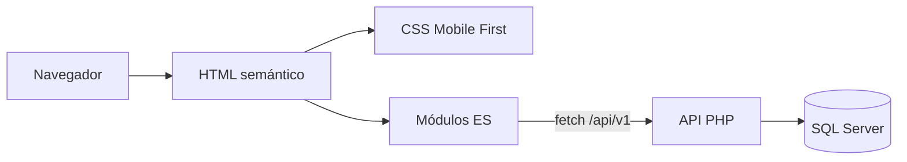

# Arquitectura del frontend

## 1. Enfoque

`appWeb` es un sitio estático multipágina (MPA) construido con HTML5, CSS3 y JavaScript nativo. No usa framework ni paso de compilación. Nginx sirve los archivos y hace proxy de `/api` al backend.



## 2. Estructura

```text
appWeb/
├── index.html
├── pages/
│   ├── servicios.html
│   ├── servicio-detalle.html
│   ├── portafolio.html
│   ├── caso-detalle.html
│   ├── nosotros.html
│   ├── contacto.html
│   ├── cotizacion.html
│   ├── login.html
│   ├── registro.html
│   ├── portal/
│   │   ├── index.html
│   │   ├── proyectos.html
│   │   ├── proyecto-detalle.html
│   │   ├── solicitudes.html
│   │   ├── solicitud-detalle.html
│   │   └── perfil.html
│   └── admin/
│       ├── dashboard.html
│       ├── usuarios.html
│       ├── clientes.html
│       ├── servicios.html
│       ├── proyectos.html
│       ├── tecnologias.html
│       ├── solicitudes.html
│       └── mensajes.html
└── assets/
    ├── css/
    │   ├── main.css
    │   └── components.css
    ├── js/
    │   ├── main.js
    │   ├── api.js
    │   ├── auth.js
    │   ├── ui.js
    │   └── pages/
    ├── img/
    └── fonts/
```

Las rutas de servicios, portafolio y CRUD son la organización prevista. En `0.2.0` existen `index.html`, `login.html`, `registro.html`, `portal/index.html` y `admin/dashboard.html`; `components.css`, `app.js` y los módulos de `pages/` ya están implementados.

## 3. Módulos JavaScript

| Módulo | Responsabilidad |
|---|---|
| `api.js` | `fetch` con base `/api/v1`, manejo de errores y CSRF |
| `auth.js` | Login, logout, `me`, guardas de ruta y estado de sesión |
| `ui.js` | Header dinámico por `data-auth`, alertas y estado de carga de botones |
| `app.js` | Arranque común: obtiene la sesión y actualiza el header |
| `pages/*.js` | Lógica específica de login, registro, portal y dashboard |

### Contrato interno implementado

```js
// api.js
export function setCsrfToken(token)
export function getCsrfToken()
export function apiGet(path)
export function apiPost(path, body)
export function apiPatch(path, body)
export function apiDelete(path)

// auth.js
export async function obtenerSesion()
export async function obtenerCsrf()
export async function iniciarSesion(email, password)
export async function registrar(datos)
export async function cerrarSesion()
export async function cambiarPassword(datos)
export function rutaPorRol(usuario)
export function redirigirPorRol(usuario)
export function protegerPagina(usuario, roles)
```

`api.js` adjunta `X-CSRF-Token` en métodos distintos de `GET`/`HEAD` y normaliza los errores de la API en un objeto con `message`, `code`, `status` y `details`.

## 4. Flujo de sesión

1. `app.js` llama `obtenerSesion()` al cargar cualquier página; esta consulta `GET /api/v1/auth/me` y guarda el token CSRF.
2. Si responde `401`, el header queda en estado de visitante.
3. En páginas protegidas, `protegerPagina(usuario, roles)` redirige a `/pages/login.html?redirect=...` si no hay sesión.
4. Si el rol no coincide, redirige a la página inicial de su rol (`portal` o `dashboard`).
5. El header se actualiza con `data-auth` (`guest`, `session`, `admin`), el nombre del usuario y el botón de logout.

> La guarda del front es solo experiencia de usuario. El backend vuelve a validar cada petición.

## 5. Consumo de la API

Fragmento real de `api.js`:

```js
const API_BASE = '/api/v1';

async function request(path, { method = 'GET', body, headers = {} } = {}) {
  const options = {
    method,
    credentials: 'same-origin',
    headers: { Accept: 'application/json', ...headers },
  };

  if (body !== undefined) {
    options.headers['Content-Type'] = 'application/json';
    options.body = JSON.stringify(body);
  }

  if (!['GET', 'HEAD'].includes(method) && csrfToken) {
    options.headers['X-CSRF-Token'] = csrfToken;
  }

  const response = await fetch(`${API_BASE}${path}`, options);
  const payload = await response.json().catch(() => ({}));

  if (!response.ok) {
    const error = new Error(payload?.error?.message ?? 'Error de comunicación');
    error.code = payload?.error?.code ?? 'ERROR';
    error.status = response.status;
    error.details = payload?.error?.details ?? {};
    throw error;
  }

  return payload.data;
}
```

- Siempre `credentials: 'same-origin'`.
- Pedir `GET /auth/csrf` antes de la primera mutación y enviar `X-CSRF-Token`.
- Mostrar estados de carga, error y vacío.
- No exponer mensajes técnicos al usuario.

## 6. Navegación

- Cada página es un documento HTML independiente.
- El header se replica en cada página; los elementos con `data-auth` se muestran u ocultan desde `ui.js`.
- Las páginas de `pages/` usan rutas absolutas (`/assets/...`, `/pages/...`) para que funcionen desde cualquier nivel de carpeta.
- Las rutas protegidas se agrupan en `pages/portal/` y `pages/admin/`.
- Los parámetros de recurso se leen con `URLSearchParams` (`?id=7`).

## 7. Estilos

- Un archivo base `main.css` con tokens y layout.
- `components.css` para tarjetas, formularios, tablas y alertas.
- Mobile First: estilos base y mejoras con `min-width`.
- Sin dependencias externas obligatorias.
- Las fuentes e imágenes se sirven localmente.

## 8. Seguridad

- No almacenar tokens ni datos sensibles en `localStorage`.
- La sesión vive en una cookie `HttpOnly`; el front no puede leerla.
- Escapar datos con `textContent`.
- Validar en cliente solo para mejorar la experiencia; el backend decide.
- No incluir claves, rutas internas ni credenciales en el código.

## 9. Compatibilidad

- Últimas dos versiones de Chrome, Firefox, Edge y Safari.
- JavaScript con módulos ES (`type="module"`).
- `fetch`, `URLSearchParams`, `Promise` y `async/await`.
- Sin polyfills en el alcance inicial.

## 10. Estado actual

`0.2.0` — Navegación dinámica, login, registro, portal y dashboard implementados; consumo de API con CSRF y guardas por rol. El sitio público completo y los módulos de negocio siguen pendientes.
