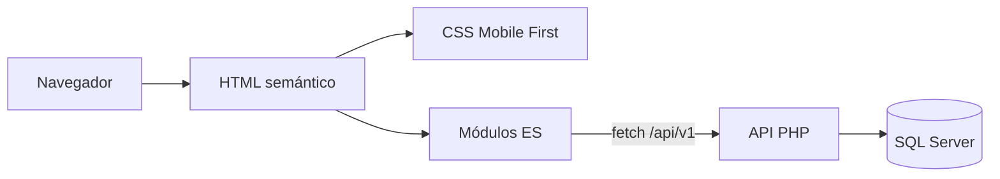

# Arquitectura del frontend

## 1. Enfoque

`appWeb` es un sitio estático multipágina (MPA) construido con HTML5, CSS3 y JavaScript nativo. No usa framework ni paso de compilación. Nginx sirve los archivos y hace proxy de `/api` al backend.



## 2. Estructura

```text
appWeb/
├── index.html
├── pages/
│   ├── servicios.html
│   ├── servicio-detalle.html
│   ├── portafolio.html
│   ├── caso-detalle.html
│   ├── nosotros.html
│   ├── contacto.html
│   ├── cotizacion.html
│   ├── login.html
│   ├── registro.html
│   ├── portal/
│   │   ├── index.html
│   │   ├── proyectos.html
│   │   ├── proyecto-detalle.html
│   │   ├── solicitudes.html
│   │   ├── solicitud-detalle.html
│   │   └── perfil.html
│   └── admin/
│       ├── dashboard.html
│       ├── usuarios.html
│       ├── clientes.html
│       ├── servicios.html
│       ├── proyectos.html
│       ├── tecnologias.html
│       ├── solicitudes.html
│       └── mensajes.html
└── assets/
    ├── css/
    │   ├── main.css
    │   └── components.css
    ├── js/
    │   ├── main.js
    │   ├── api.js
    │   ├── auth.js
    │   ├── ui.js
    │   └── pages/
    ├── img/
    └── fonts/
```

Las rutas anteriores son la organización prevista; en `0.1.0` solo existe `index.html`.

## 3. Módulos JavaScript

| Módulo | Responsabilidad |
|---|---|
| `api.js` | `fetch` con base `/api/v1`, manejo de errores y CSRF |
| `auth.js` | Login, logout, `me`, guardas de ruta y estado de sesión |
| `ui.js` | Header dinámico, alertas, modales, estados de carga y vacíos |
| `pages/*.js` | Lógica específica de cada página |

### Contrato interno sugerido

```js
// api.js
export async function apiGet(path) { /* ... */ }
export async function apiPost(path, body) { /* ... */ }
export async function apiPatch(path, body) { /* ... */ }
export async function apiDelete(path) { /* ... */ }

// auth.js
export async function iniciarSesion(credenciales) { /* ... */ }
export async function cerrarSesion() { /* ... */ }
export async function obtenerSesion() { /* ... */ }
export function requerirRol(rol) { /* redirige si no coincide */ }
```

## 4. Flujo de sesión

1. Al cargar una página protegida, `auth.js` llama `GET /api/v1/auth/me`.
2. Si responde `401`, redirige a `/pages/login.html` con `?redirect=...`.
3. Si el rol no coincide, muestra acceso denegado y ofrece volver al portal.
4. El header se actualiza con el nombre del usuario y las opciones de su rol.

> La guarda del front es solo experiencia de usuario. El backend vuelve a validar cada petición.

## 5. Consumo de la API

```js
export async function apiFetch(path, options = {}) {
  const response = await fetch(`/api/v1${path}`, {
    credentials: 'same-origin',
    headers: {
      'Content-Type': 'application/json',
      ...(options.headers ?? {}),
    },
    ...options,
  });

  const payload = await response.json().catch(() => ({}));

  if (!response.ok) {
    throw new Error(payload?.error?.message ?? 'Error de comunicación');
  }

  return payload.data;
}
```

- Siempre `credentials: 'same-origin'`.
- Enviar `X-CSRF-Token` en mutaciones.
- Mostrar estados de carga, error y vacío.
- No exponer mensajes técnicos al usuario.

## 6. Navegación

- Cada página es un documento HTML independiente.
- El encabezado y el pie se replican o se insertan con un pequeño include de JavaScript.
- Los enlaces usan rutas relativas para funcionar en el contenedor.
- Las rutas protegidas se agrupan en `pages/portal/` y `pages/admin/`.
- Los parámetros de recurso se leen con `URLSearchParams` (`?id=7`).

## 7. Estilos

- Un archivo base `main.css` con tokens y layout.
- `components.css` para tarjetas, formularios, tablas y alertas.
- Mobile First: estilos base y mejoras con `min-width`.
- Sin dependencias externas obligatorias.
- Las fuentes e imágenes se sirven localmente.

## 8. Seguridad

- No almacenar tokens ni datos sensibles en `localStorage`.
- La sesión vive en una cookie `HttpOnly`; el front no puede leerla.
- Escapar datos con `textContent`.
- Validar en cliente solo para mejorar la experiencia; el backend decide.
- No incluir claves, rutas internas ni credenciales en el código.

## 9. Compatibilidad

- Últimas dos versiones de Chrome, Firefox, Edge y Safari.
- JavaScript con módulos ES (`type="module"`).
- `fetch`, `URLSearchParams`, `Promise` y `async/await`.
- Sin polyfills en el alcance inicial.

## 10. Estado actual

`0.1.0` — Estructura y estilos base. No hay navegación ni consumo de API implementados.
