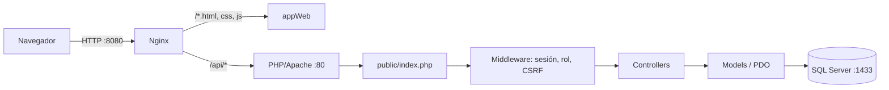

# Arquitectura del backend

## 1. Visión general

El backend es una API REST en PHP 8.3 que se ejecuta sobre Apache y accede a SQL Server 2022 mediante PDO (`sqlsrv`). El front estático `appWeb` consume la API a través del proxy de Nginx, de modo que navegador y API comparten el mismo origen.



## 2. Capas

| Capa | Carpeta | Responsabilidad |
|---|---|---|
| Entrada | `public/index.php` | Único punto de entrada; carga configuración y enruta |
| Middleware | `app/middleware/` | Sesión, roles, CSRF, rate limit y validación común |
| Controladores | `app/controllers/` | Interpretan la petición y devuelven JSON |
| Modelos | `app/models/` | Consultas preparadas y mapeo de datos |
| Helpers | `app/helpers/` | Respuestas, validación, fechas y utilidades |
| Configuración | `config/` | Variables de entorno y conexión PDO |

## 3. Flujo de una petición

1. Nginx recibe `GET /api/v1/servicios`.
2. El proxy reenvía la ruta sin cambios a Apache.
3. `public/index.php` construye la ruta y el método.
4. Se aplica el middleware correspondiente:
   - Público: solo validación y rate limit si aplica.
   - Autenticado: verifica sesión.
   - Admin: verifica rol.
   - Mutaciones: verifica token CSRF.
5. El controlador valida la entrada y llama al modelo.
6. El modelo ejecuta una consulta preparada en SQL Server.
7. El controlador devuelve `{ "data": ... }` o `{ "error": ... }`.

## 4. Enrutamiento

- Prefijo base: `/api/v1`.
- Recursos en plural y en español: `/servicios`, `/proyectos`, `/solicitudes`.
- Identificadores numéricos para recursos internos y `slug` para contenido público.
- Rutas anidadas solo cuando existe una relación clara: `/mi/proyectos/{id}`.
- El front controller implementará una tabla de rutas; no se usarán archivos PHP por endpoint.

Ejemplo conceptual:

```php
$rutas = [
    'GET /api/v1/servicios' => [ServicioController::class, 'index'],
    'GET /api/v1/servicios/{slug}' => [ServicioController::class, 'show'],
    'POST /api/v1/auth/login' => [AuthController::class, 'login'],
    'GET /api/v1/mi/proyectos' => [ProyectoController::class, 'misProyectos'],
];
```

## 5. Formato de respuesta

Éxito:

```json
{
  "data": {
    "id": 1,
    "nombre": "Desarrollo web"
  }
}
```

Lista paginada:

```json
{
  "data": [],
  "meta": {
    "page": 1,
    "per_page": 20,
    "total": 0,
    "total_pages": 0
  }
}
```

Error:

```json
{
  "error": {
    "code": "VALIDACION",
    "message": "Los datos enviados no son válidos.",
    "details": {
      "email": "El correo no tiene un formato válido."
    }
  }
}
```

## 6. Sesiones y CSRF

- La sesión se crea en `POST /api/v1/auth/login`.
- La cookie se configura con `HttpOnly`, `SameSite=Lax` y `Secure` en producción.
- `GET /api/v1/auth/me` devuelve el usuario y un token CSRF.
- Las mutaciones requieren el header `X-CSRF-Token`.
- El backend regenera el ID de sesión después del login para evitar fijación de sesión.

## 7. Configuración

Toda la configuración se lee de variables de entorno:

| Variable | Uso |
|---|---|
| `APP_ENV` | `development` o `production` |
| `APP_URL` | URL base para enlaces y cookies |
| `DB_HOST`, `DB_PORT` | Conexión a SQL Server |
| `DB_NAME`, `DB_USER`, `DB_PASSWORD` | Credenciales |
| `SESSION_NAME`, `SESSION_SECURE` | Cookie de sesión |
| `API_PREFIX` | Prefijo de la API |

El archivo `.env` no se versiona. `.env.example` documenta las variables.

## 8. Manejo de errores

- En desarrollo se registran detalles en el log y se devuelve información útil.
- En producción no se exponen trazas ni consultas SQL.
- Los errores de validación usan `422`.
- Los errores de autenticación usan `401`; los de autorización, `403`.
- Los recursos inexistentes usan `404`.
- Los conflictos (correo duplicado, transición inválida) usan `409`.
- Los límites de peticiones usan `429`.

## 9. Dependencias y versionado

- PHP 8.3 con `pdo_sqlsrv` y `sqlsrv`.
- SQL Server 2022.
- Sin framework: se implementará un enrutador y un contenedor simple para mantener el proyecto comprensible.
- La API se versiona en la ruta (`/v1`); los cambios incompatibles crean `/v2`.

## 10. Estado actual

`0.1.0` — Solo existe el front controller con respuestas informativas. Las capas, rutas y modelos están definidos en la documentación y pendientes de implementación.
