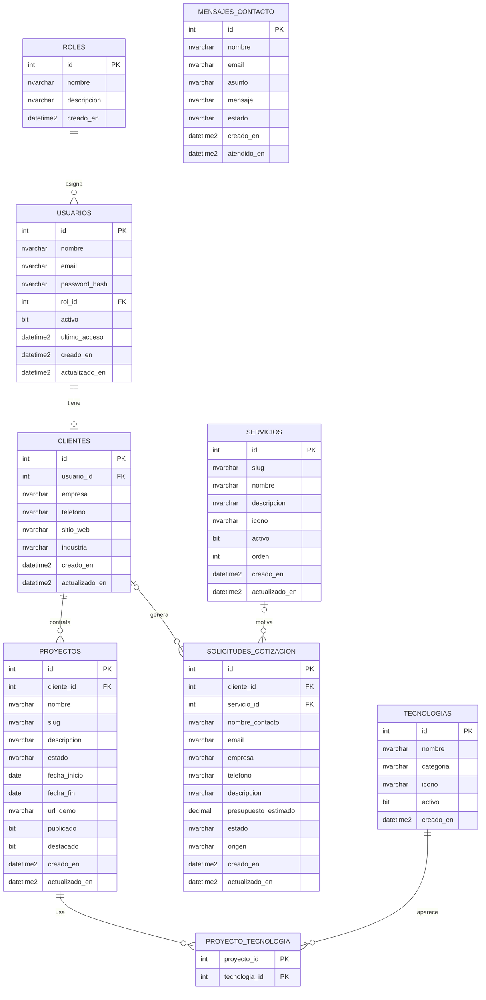

# Modelo entidad-relación

Diseño inicial de la base de datos `DevStudioDB` para SQL Server 2022.

## 1. Diagrama

## 2. Entidades

| Entidad | Propósito |
|---|---|
| `Roles` | Catálogo de roles (`admin`, `cliente`). |
| `Usuarios` | Credenciales, datos de acceso y rol. |
| `Clientes` | Perfil de empresa vinculado a un usuario. |
| `Servicios` | Catálogo público de servicios. |
| `Tecnologias` | Catálogo de tecnologías para clasificar proyectos. |
| `Proyectos` | Proyectos contratados y casos de portafolio. |
| `ProyectoTecnologia` | Relación N:M entre proyectos y tecnologías. |
| `SolicitudesCotizacion` | Prospectos y solicitudes de cotización. |
| `MensajesContacto` | Mensajes del formulario público. |

## 3. Relaciones

| Relación | Cardinalidad | Regla |
|---|---|---|
| `Roles` → `Usuarios` | 1:N | Todo usuario tiene un rol. |
| `Usuarios` → `Clientes` | 1:0..1 | Un usuario cliente puede tener un perfil de empresa; el admin no. |
| `Clientes` → `Proyectos` | 1:N | Un proyecto pertenece a un cliente. |
| `Clientes` → `SolicitudesCotizacion` | 1:0..N | Una solicitud puede ser pública (sin cliente) o del portal. |
| `Servicios` → `SolicitudesCotizacion` | 1:0..N | La solicitud puede indicar un servicio de interés. |
| `Proyectos` ↔ `Tecnologias` | N:M | Se resuelve con `ProyectoTecnologia`. |
| `MensajesContacto` | Independiente | No requiere usuario registrado. |

## 4. Decisiones de diseño

- **Borrado lógico:** `Usuarios.activo`, `Servicios.activo`, `Tecnologias.activo`; no se elimina historial.
- **Solicitudes sin cuenta:** `cliente_id` es nullable para permitir cotizaciones públicas.
- **Portafolio:** se reutiliza `Proyectos` con `publicado = 1` y `slug` único para la vista pública.
- **Estados:** se validan con `CHECK` y con transiciones en el backend.
- **Fechas:** `DATETIME2(0)` en UTC para auditoría; `DATE` para fechas de proyecto.
- **Dinero:** `DECIMAL(12,2)` para presupuestos; nunca `FLOAT`.
- **Textos:** `NVARCHAR` para soportar acentos y caracteres especiales.
- **Correo:** `NVARCHAR(254)` con índice único en `Usuarios.email`.
- **Un usuario por cliente:** en el alcance inicial, cada empresa tiene un usuario de contacto (`Clientes.usuario_id` es único). Si se requiere más de uno, se añadirá una tabla de usuarios por cliente en una migración futura.

## 5. Índices previstos

| Tabla | Índice | Tipo |
|---|---|---|
| `Usuarios` | `email` | Único |
| `Clientes` | `usuario_id` | Único |
| `Servicios` | `slug` | Único |
| `Proyectos` | `slug` | Único |
| `Proyectos` | `cliente_id`, `estado`, `publicado` | No único |
| `SolicitudesCotizacion` | `estado`, `email`, `cliente_id` | No único |
| `MensajesContacto` | `estado` | No único |
| `ProyectoTecnologia` | `(proyecto_id, tecnologia_id)` | PK compuesta |

## 6. Entidades futuras

- `ProyectoImagen` para la galería del portafolio.
- `Notificacion` para avisos internos.
- `Auditoria` para registrar cambios administrativos.
- `Testimonio` para opiniones de clientes.
- `TokenRecuperacion` si se habilita la recuperación de contraseña.

## 7. Scripts

- Esquema: [`../../database/schema.sql`](../../database/schema.sql).
- Datos iniciales: [`../../database/seed.sql`](../../database/seed.sql).
- Diccionario de datos: [`02-diccionario-datos.md`](02-diccionario-datos.md).
