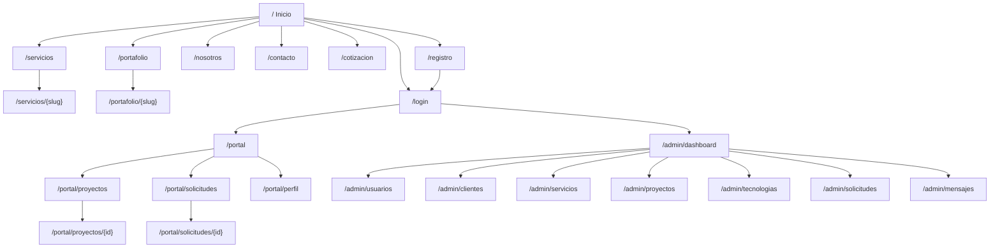

# Mapa de sitio

Estructura de páginas y rutas del sistema. El front es estático y consume la API; las rutas protegidas se validan en el servidor.

> Las rutas mostradas son las URLs públicas objetivo. En el andamiaje los archivos viven en `appWeb/pages/` y Nginx podrá mapear las URLs limpias cuando se implemente la navegación.

## 1. Árbol de navegación

```text
/
├── /servicios
│   └── /servicios/{slug}
├── /portafolio
│   └── /portafolio/{slug}
├── /nosotros
├── /contacto
├── /cotizacion
├── /login
├── /registro
│
├── /portal                         (rol: cliente)
│   ├── /portal/proyectos
│   │   └── /portal/proyectos/{id}
│   ├── /portal/solicitudes
│   │   └── /portal/solicitudes/{id}
│   └── /portal/perfil
│
└── /admin                          (rol: admin)
    ├── /admin/dashboard
    ├── /admin/usuarios
    ├── /admin/clientes
    ├── /admin/servicios
    ├── /admin/proyectos
    ├── /admin/tecnologias
    ├── /admin/solicitudes
    └── /admin/mensajes
```

## 2. Sitio público

| Página | Ruta | Contenido | Acción principal |
|---|---|---|---|
| Inicio | `/` | Propuesta de valor, servicios destacados, portafolio y llamada a la acción | Ir a cotización |
| Servicios | `/servicios` | Catálogo de servicios | Ver detalle |
| Detalle de servicio | `/servicios/{slug}` | Descripción, tecnologías y beneficios | Solicitar cotización |
| Portafolio | `/portafolio` | Casos de éxito publicados | Ver caso |
| Detalle de caso | `/portafolio/{slug}` | Reto, solución, tecnologías y resultados | Contactar |
| Nosotros | `/nosotros` | Historia, equipo y enfoque de trabajo | Contactar |
| Contacto | `/contacto` | Formulario y datos de la empresa | Enviar mensaje |
| Cotización | `/cotizacion` | Formulario de solicitud | Enviar solicitud |
| Login | `/login` | Inicio de sesión | Entrar al portal |
| Registro | `/registro` | Alta de cliente | Crear cuenta |

## 3. Portal del cliente

| Página | Ruta | Contenido | Restricción |
|---|---|---|---|
| Resumen | `/portal` | Bienvenida y accesos rápidos | Sesión de cliente |
| Proyectos | `/portal/proyectos` | Lista de proyectos propios | Solo propios |
| Detalle de proyecto | `/portal/proyectos/{id}` | Estado, fechas, tecnologías y enlaces | Solo propios |
| Solicitudes | `/portal/solicitudes` | Historial de solicitudes | Solo propias |
| Detalle de solicitud | `/portal/solicitudes/{id}` | Estado y respuesta | Solo propias |
| Perfil | `/portal/perfil` | Datos de contacto y contraseña | Sesión de cliente |

## 4. Panel de administración

| Página | Ruta | Contenido | Restricción |
|---|---|---|---|
| Dashboard | `/admin/dashboard` | Métricas, solicitudes y mensajes recientes | Rol admin |
| Usuarios | `/admin/usuarios` | Altas, edición, rol y estado | Rol admin |
| Clientes | `/admin/clientes` | Empresas y contactos | Rol admin |
| Servicios | `/admin/servicios` | CRUD de servicios | Rol admin |
| Proyectos | `/admin/proyectos` | CRUD y publicación en portafolio | Rol admin |
| Tecnologías | `/admin/tecnologias` | Catálogo de tecnologías | Rol admin |
| Solicitudes | `/admin/solicitudes` | Bandeja y cambio de estado | Rol admin |
| Mensajes | `/admin/mensajes` | Bandeja de contacto | Rol admin |

## 5. Diagrama general



## 6. Reglas de visibilidad

- El menú público siempre muestra Inicio, Servicios, Portafolio, Nosotros, Contacto y Cotización.
- Si no hay sesión, se muestran **Iniciar sesión** y **Crear cuenta**.
- Con sesión de cliente, se muestra **Mi portal** y **Cerrar sesión**.
- Con sesión de admin, se muestra **Panel administrativo** y **Cerrar sesión**.
- Las rutas `/portal/*` y `/admin/*` redirigen a `/login` si no hay sesión.
- Un cliente que intenta abrir `/admin/*` recibe un `403` del backend y el front muestra una página de acceso denegado.
- Las rutas inexistentes muestran una página `404` con enlace al inicio.
