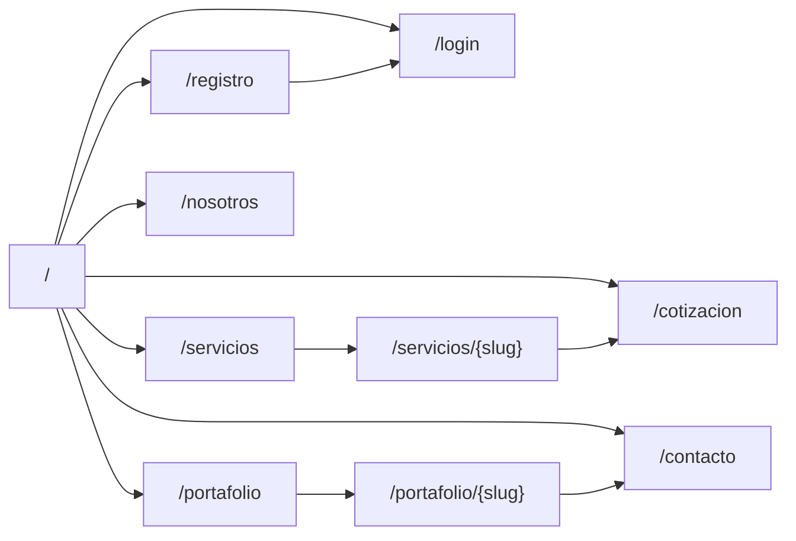
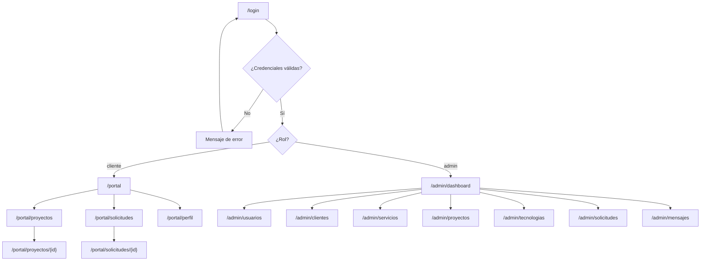
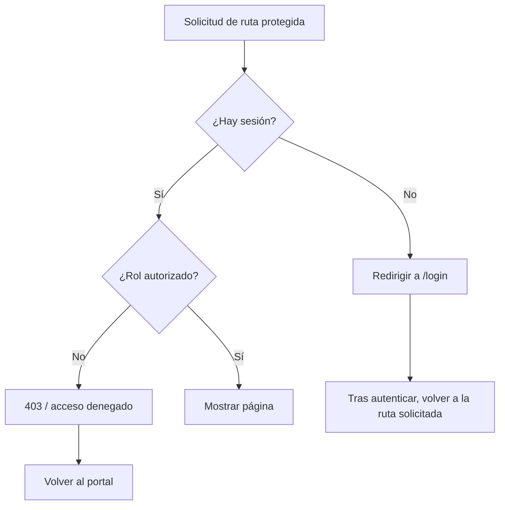

# Diagrama de navegación

Flujos de navegación y restricciones de acceso. Las flechas representan transiciones visibles para el usuario; la autorización real se valida en el backend.

> En la implementación estática actual las rutas equivalen a archivos `.html` y los detalles usan `?slug=`: `/pages/servicios.html`, `/pages/servicio-detalle.html?slug=...`, `/pages/portafolio.html` y `/pages/caso-detalle.html?slug=...`. Las rutas limpias quedan como mejora futura.

## 1. Navegación pública

## 2. Acceso y redirección por rol

## 3. Restricciones y salidas

## 4. Matriz de rutas

| Ruta | Visitante | Cliente | Admin | Comportamiento sin permiso |
|---|---|---|---|---|
| `/`, `/servicios`, `/portafolio`, `/nosotros`, `/contacto`, `/cotizacion` | ✅ | ✅ | ✅ | — |
| `/login`, `/registro` | ✅ | Redirige al portal | Redirige al panel | — |
| `/portal`, `/portal/proyectos`, `/portal/solicitudes`, `/portal/perfil` | ❌ | ✅ | ✅ | Redirige a `/login` |
| `/admin`, `/admin/*` | ❌ | ❌ | ✅ | `403` y enlace al portal |
| Ruta inexistente | ❌ | ❌ | ❌ | Página `404` |

## 5. Reglas de navegación

- El encabezado cambia según la sesión: visitante, cliente o admin.
- Tras iniciar sesión, se redirige al destino solicitado o al inicio del rol.
- Al cerrar sesión se limpia el estado local y se vuelve a `/`.
- Las rutas del portal incluyen el identificador del recurso, pero el backend verifica la propiedad.
- Los formularios conservan los datos capturados cuando hay errores de validación.
- Las acciones destructivas piden confirmación y muestran el resultado.
