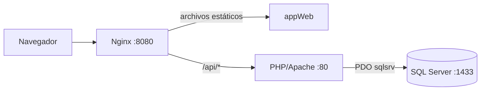

# Manual técnico

**Sistema:** `[Nombre de la empresa]` — sitio web, portal de clientes y panel administrativo
**Versión:** 0.2.0 · **Última actualización:** 2026-11-13

> Documento en construcción. Este índice consolida la instalación, la arquitectura y la operación; el detalle de cada componente vive en `backEnd/docs` y `appWeb/docs`.

## Contenido

1. [Descripción general](#1-descripción-general)
2. [Arquitectura](#2-arquitectura)
3. [Requisitos](#3-requisitos)
4. [Instalación con Docker](#4-instalación-con-docker)
5. [Configuración](#5-configuración)
6. [Base de datos](#6-base-de-datos)
7. [API](#7-api)
8. [Frontend](#8-frontend)
9. [Seguridad](#9-seguridad)
10. [Operación y respaldos](#10-operación-y-respaldos)
11. [Solución de problemas](#11-solución-de-problemas)
12. [Referencias](#12-referencias)

## 1. Descripción general

Aplicación web para una empresa desarrolladora de software. Se compone de un front estático (`appWeb`) y una API PHP (`backEnd`) que persiste en SQL Server 2022.

| Componente | Tecnología | Puerto |
|---|---|---|
| Frontend | HTML5, CSS3, JavaScript | `8080` (Nginx) |
| API | PHP 8.3 + Apache | Interno `80` |
| Base de datos | SQL Server 2022 | `1433` |
| Proxy | Nginx | `8080` |

## 2. Arquitectura



- **Mismo origen:** el navegador solo habla con `localhost:8080`; Nginx hace proxy de `/api` al backend. Esto permite cookies de sesión sin CORS.
- **Separación de responsabilidades:** el front no contiene reglas de negocio; el backend no contiene HTML.
- **Configuración por entorno:** credenciales y parámetros en `.env`.

Detalle: [`backEnd/docs/01-arquitectura.md`](../../backEnd/docs/01-arquitectura.md) y [`appWeb/docs/01-arquitectura-front.md`](../../appWeb/docs/01-arquitectura-front.md).

## 3. Requisitos

### Desarrollo

- Docker Engine 24+ y Docker Compose v2.
- 2 GB de RAM libres para SQL Server.
- `x86_64` (la imagen de SQL Server para Linux no es compatible de forma nativa con ARM).
- Puertos `8080` y `1433` disponibles.
- Cliente de base de datos: Azure Data Studio, DBeaver o `sqlcmd`.

### Producción

- Servidor Linux con Docker o servicios equivalentes.
- HTTPS y dominio.
- Usuario de SQL Server con permisos mínimos (no usar `sa`).
- Política de respaldos y monitoreo.

## 4. Instalación con Docker

```bash
cd proyecto-final
cp .env.example .env
# Editar .env: cambiar DB_PASSWORD y APP_URL
docker compose up -d --build
docker compose ps
```

Verificar la API:

```bash
curl http://localhost:8080/api/v1/health
```

Verificar las extensiones de PHP:

```bash
docker compose exec api php -m | grep -i sqlsrv
```

Cargar el esquema y los datos iniciales (incluye cuentas y datos de demostración):

```bash
docker compose exec -T mssql /bin/bash -c \
  '/opt/mssql-tools18/bin/sqlcmd -S localhost -U sa -P "$MSSQL_SA_PASSWORD" -C -i /dev/stdin' \
  < backEnd/database/schema.sql

docker compose exec -T mssql /bin/bash -c \
  '/opt/mssql-tools18/bin/sqlcmd -S localhost -U sa -P "$MSSQL_SA_PASSWORD" -C -i /dev/stdin' \
  < backEnd/database/seed.sql
```

Cuentas de prueba: `admin@devstudio.local` / `Admin#2026` y `cliente@devstudio.local` / `Cliente#2026`.

Crear el administrador inicial con tus propias variables (opcional; el seed ya crea un administrador):

```bash
docker compose exec api php scripts/crear-admin.php
```

Entrar a <http://localhost:8080/pages/login.html> con las credenciales de prueba o con `ADMIN_EMAIL` y `ADMIN_PASSWORD` si ejecutaste el script.

Detener el entorno:

```bash
docker compose down          # conserva el volumen de datos
docker compose down -v       # elimina también la base de datos
```

## 5. Configuración

Variables principales de `.env`:

| Variable | Descripción | Ejemplo |
|---|---|---|
| `APP_ENV` | Entorno | `development` |
| `APP_NAME` | Nombre visible | `[Nombre de la empresa]` |
| `APP_URL` | URL base | `http://localhost:8080` |
| `APP_TIMEZONE` | Zona horaria de PHP | `America/Mexico_City` |
| `WEB_PORT` | Puerto del front | `8080` |
| `DB_HOST` | Host de SQL Server | `mssql` |
| `DB_PORT` | Puerto | `1433` |
| `DB_NAME` | Base de datos | `DevStudioDB` |
| `DB_USER` | Usuario | `sa` (solo desarrollo) |
| `DB_PASSWORD` | Contraseña | `[secreto]` |
| `DB_ENCRYPT` | Cifrado de la conexión | `true` |
| `DB_TRUST_CERT` | Confiar en certificado | `true` solo en desarrollo |
| `SESSION_NAME` | Nombre de cookie | `devstudio_session` |
| `SESSION_SECURE` | Cookie solo HTTPS | `false` en desarrollo |
| `SESSION_SAMESITE` | Política SameSite | `Lax` |
| `API_PREFIX` | Prefijo de API | `/api/v1` |
| `ADMIN_NAME` | Nombre del administrador inicial | `Administrador` |
| `ADMIN_EMAIL` | Correo del administrador | `admin@devstudio.local` |
| `ADMIN_PASSWORD` | Contraseña del administrador | `[secreto fuerte]` |
| `RATE_LIMIT_DIR` | Carpeta del rate limit | `sys_get_temp_dir()/devstudio-rate-limit` |

> Nunca versionar `.env`. En producción usar secretos del proveedor y `SESSION_SECURE=true`.

## 6. Base de datos

- Motor: SQL Server 2022 Developer.
- Scripts: `backEnd/database/schema.sql`, `seed.sql` y `migrations/`.
- Modelo: [`backEnd/docs/02-base-datos/01-modelo-er.md`](../../backEnd/docs/02-base-datos/01-modelo-er.md).
- Diccionario: [`backEnd/docs/02-base-datos/02-diccionario-datos.md`](../../backEnd/docs/02-base-datos/02-diccionario-datos.md).

Conexión desde el host:

| Parámetro | Valor |
|---|---|
| Servidor | `localhost,1433` |
| Usuario | `sa` |
| Contraseña | la definida en `.env` |
| Base de datos | `DevStudioDB` |
| Cifrado | `TrustServerCertificate=true` en desarrollo |

## 7. API

- Base: `/api/v1`.
- Formato: JSON.
- Autenticación: cookie de sesión + token CSRF.
- Contrato completo: [`backEnd/docs/03-api.md`](../../backEnd/docs/03-api.md).

Rutas implementadas en la versión 0.2.0:

| Método | Ruta | Acceso |
|---|---|---|
| GET | `/api/v1` | Público |
| GET | `/api/v1/health` | Público; consulta `SELECT 1` en SQL Server |
| GET | `/api/v1/auth/csrf` | Público |
| POST | `/api/v1/auth/login` | Público; rate limit 5/15 min por IP y correo |
| POST | `/api/v1/auth/logout` | Autenticado |
| GET | `/api/v1/auth/me` | Autenticado |
| POST | `/api/v1/auth/registro` | Público; crea usuario `cliente` y empresa |
| PATCH | `/api/v1/auth/password` | Autenticado |
| GET | `/api/v1/admin/dashboard` | Solo `admin` |

Ejemplo:

```bash
curl -i http://localhost:8080/api/v1/health
```

## 8. Frontend

- Sitio estático servido por Nginx desde `appWeb/`.
- CSS Mobile First con variables y breakpoints en 480, 768 y 1024 px. `main.css` contiene la base y `components.css` los formularios, botones, alertas y paneles.
- JavaScript modular: `api.js` (fetch + CSRF), `auth.js` (sesión, roles y guardas), `ui.js` (header y alertas), `app.js` (arranque) y `pages/` (login, registro, portal y admin).
- Páginas de la etapa: `/index.html`, `/pages/login.html`, `/pages/registro.html`, `/pages/portal/index.html` y `/pages/admin/dashboard.html`.
- El front oculta enlaces por rol con `data-auth`, pero el backend siempre valida la sesión y el rol.
- Documentación: [`appWeb/docs/`](../../appWeb/docs/).

## 9. Seguridad

Resumen; detalle en [`backEnd/docs/04-seguridad.md`](../../backEnd/docs/04-seguridad.md).

- Contraseñas con `password_hash` y `password_verify`.
- PDO con consultas preparadas.
- Sesiones `HttpOnly`, `SameSite` y `Secure` en producción.
- Token CSRF en `POST`, `PATCH` y `DELETE`.
- Autorización por rol y propiedad del recurso en el backend.
- Validación y saneamiento de entradas.
- Rate limit en login, contacto y cotizaciones.
- HTTPS obligatorio en producción.

## 10. Operación y respaldos

```bash
# Respaldo lógico
docker compose exec mssql mkdir -p /var/opt/mssql/backup
docker compose exec mssql bash -c "/opt/mssql-tools18/bin/sqlcmd -S localhost -U sa -P \"\$MSSQL_SA_PASSWORD\" -C -Q \"BACKUP DATABASE [DevStudioDB] TO DISK = N'/var/opt/mssql/backup/DevStudioDB.bak' WITH INIT\""

# Copiar el respaldo al host
docker compose cp mssql:/var/opt/mssql/backup/DevStudioDB.bak ./dist/
```

- Programar respaldos antes de cada entrega.
- Verificar la restauración en un entorno limpio.
- No incluir respaldos ni `.env` en el ZIP de entrega.

## 11. Solución de problemas

| Síntoma | Causa probable | Solución |
|---|---|---|
| `sqlsrv` no aparece en `php -m` | Falló la compilación de la extensión | Revisar `docker compose logs api` y reconstruir sin caché |
| `Login failed for user 'sa'` | Contraseña distinta o política incumplida | Revisar `.env`; la contraseña debe cumplir complejidad |
| SQL Server se reinicia | Memoria insuficiente | Asignar al menos 2 GB a Docker |
| `502 Bad Gateway` en `/api` | El contenedor `api` no está listo | `docker compose logs api` y `docker compose ps` |
| La web no carga estilos | Ruta o volumen incorrecto | Verificar el montaje de `appWeb` en `compose.yaml` |
| Error de arquitectura de imagen | Host ARM | Usar un host `x86_64` o emulación |
| `429 DEMASIADAS_PETICIONES` | Rate limit de login | Esperar 15 minutos o limpiar `devstudio-rate-limit` |
| `403 CSRF_INVALIDO` | Token ausente o viejo | Volver a pedir `/api/v1/auth/csrf` y reenviar el header |
| `health` con `database: error` | Falla la conexión PDO | Revisar `DB_*`, contenedor `mssql` y extensión `sqlsrv` |
| El administrador no existe | No se ejecutó el script | `docker compose exec api php scripts/crear-admin.php` |

## 12. Referencias

- [README del proyecto](../../README.md)
- [Checklist de entregables](../00-checklist-entregables.md)
- [Documentación del backend](../../backEnd/docs/)
- [Documentación del frontend](../../appWeb/docs/)
- [Changelog del backend](../../backEnd/CHANGELOG.md)
- [Changelog del frontend](../../appWeb/CHANGELOG.md)
- [Changelog de documentación](../CHANGELOG.md)

## Historial de cambios del manual

| Versión | Fecha | Cambio |
|---|---|---|
| 0.1.0 | 2026-11-13 | Estructura inicial del manual técnico |
| 0.2.0 | 2026-11-13 | Instalación de BD, alta de administrador, rutas de autenticación y solución de problemas de CSRF/rate limit |
